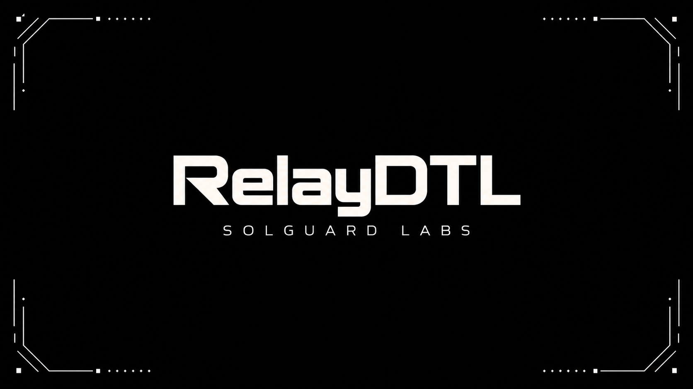
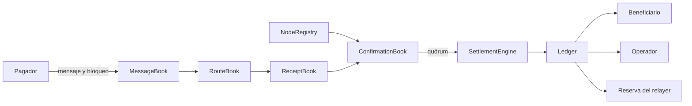

# RelayDTL



RelayDTL coordina entregas DTL entre nodos con reserva de fondos, selección de rutas, recibos de entrega, confirmaciones ponderadas y liquidación. Su núcleo Go mantiene el libro por activo y una CLI reproduce operaciones desde JSON; las pruebas TypeScript ejercitan recorridos completos del protocolo.

## Arquitectura



El pagador bloquea `principal + fee_limit` al enviar un mensaje. Una ruta admitida produce un recibo que fija activo, importe, operador, contexto, ventana y digest. Las confirmaciones de nodos activos aportan peso al quórum. La liquidación acredita principal y fee, devuelve el margen de fee no utilizado y registra la fuente del cargo. La reserva del relayer puede completar importes cuando la política lo permite.

## Ejecución

Requiere Go 1.22+, Node.js 22+ y npm. El escenario de ejemplo no depende de servicios externos:

```bash
git clone https://github.com/SolguardLabs/RelayDTL.git
cd RelayDTL
go run ./cmd/relaydtl --scenario ./examples/settlement.json
go test ./...
npm ci
npm test
bash scripts/ci.sh
```

La CLI también acepta `--demo`. En Windows, `.\scripts\ci.ps1` ejecuta formato, tests y `go vet` desde PowerShell.

## Modelo económico

```text
bloqueo inicial = principal + fee_limit
fee de ruta = base_fee + ceil(principal × fee_bps / 10 000) + fees de hops
importe de liquidación = principal + fee de ruta
reembolso de fee = fee_limit − fee de ruta
```

Para un mensaje de 1.000 USDC con `fee_limit = 25`, una ruta de 20 bps genera fee 2. Tras quórum, el beneficiario recibe 1.000, el operador 2 y el pagador recupera 23 del bloqueo. Los importes son unidades enteras declaradas por el escenario. `Ledger.AssertConserved` compara la suma por activo antes y después de las operaciones; las vistas de saldo separan disponible y retenido.

Consulte [arquitectura](docs/arquitectura.md), [modelo económico](docs/modelo-economico.md), [integración](docs/integracion.md), [operación](docs/operacion.md) y [seguridad operativa](docs/seguridad-operativa.md). La comunicación privada de hallazgos se describe en [SECURITY.md](SECURITY.md).

## Estructura

- `src/`: cuentas, importes, mensajes, rutas, recibos, confirmaciones, liquidación y snapshots.
- `cmd/relaydtl/`: CLI JSON.
- `examples/`: escenario de entrega normal.
- `tests/node/` y `src/*_test.go`: integración y unidades económicas.
- `scripts/`: validación reproducible en Bash y PowerShell.

La CLI usa estado en memoria y no implementa transporte de red, firma de mensajes, persistencia ni custodia externa. La integración con infraestructura de nodos requiere esos componentes y una revisión independiente de sus garantías.
