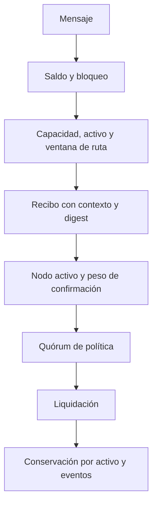

# Política de seguridad

RelayDTL separa admisión de mensajes, elección de ruta, confirmaciones y aplicación económica en el libro. El alcance de revisión incluye `src/`, la CLI en `cmd/` y las pruebas Go/TypeScript.

Los controles cubren saldos disponibles y retenidos, expiración, capacidad y latencia de rutas, límites de fee, actividad de nodos, quórum ponderado y conservación de unidades por activo. Los códigos de error distinguen entrada inválida, política, fondos insuficientes, falta de quórum y estado cerrado. Las pruebas ejercitan los recorridos admitidos, rechazos y redondeo económico.

## Supuestos

El proceso es local y no verifica firmas ni consenso entre nodos externos. Los digests identifican contenido de dominio, pero no sustituyen autenticación o un registro persistente. Una suma global conservada es una señal contable, no una revisión integral de todas las reglas de negocio.

## Divulgación responsable

Comuníque los hallazgos mediante [GitHub Security Advisories](../../security/advisories/new), no en un issue abierto. Incluya commit, precondiciones, impacto, reproducción mínima y evidencia de balances. No utilice fondos ni sistemas de terceros para validar informes. Los pasos de respuesta deben coordinarse antes de publicar detalles técnicos.
