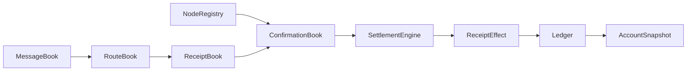
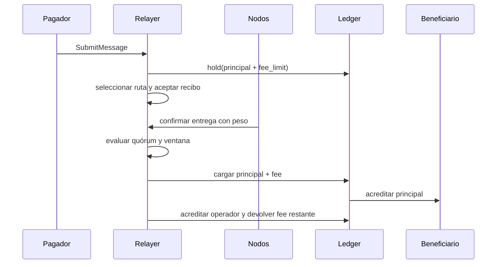

# Arquitectura de RelayDTL

El relayer mantiene seis dominios: cuentas y saldos, mensajes, rutas, recibos, confirmaciones y efectos de liquidación. `Relayer` orquesta las llamadas; `Ledger` es la fuente de verdad de disponible y retenido por activo. Los snapshots y eventos hacen observable el recorrido sin transporte de red.

## Secuencia de entrega

Los IDs de mensaje, recibo, ruta y contexto identifican objetos distintos. El recibo captura un digest de la ruta; cada confirmación añade nodo, estado, peso y época. El `SettlementEngine` mantiene el estado del efecto económico de cada recibo, mientras el diario registra débitos, créditos, retenciones y liberaciones.

## Estados

`Message` pasa por abierto, encaminado, entregado y liquidado, o termina por expiración/cancelación. Un recibo aceptado puede liquidarse o quedar fuera de ventana. Las confirmaciones de nodos retirados o pausados no cuentan. La política fija quórum, peso de rechazo, TTL y tolerancia temporal.
