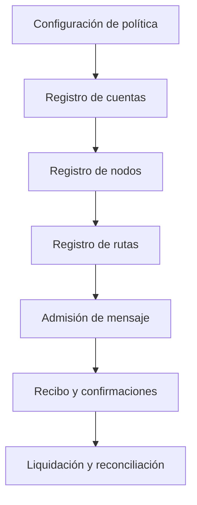

# Integración con operadores y nodos

El proyecto expone un motor Go y una CLI de escenarios JSON. Una integración de servicio debe suministrar transporte autenticado, persistencia transaccional, identificación de nodos y recuperación ante reinicios; la CLI no implementa esas capas.

## Admisión

1. Registre cuentas por tipo (usuario, operador, reserva) y activo.
2. Registre nodos con peso, operador y estado activo.
3. Configure rutas con extremos, activo, capacidad, fee base, bps, congestión opcional, latencia y ventana.
4. Configure política de quórum, rechazo, TTL, deriva y completado por reserva.
5. Envíe mensajes con `message_id` único, pagador, beneficiario, principal y fee máximo.

La selección de ruta usa estado, capacidad, activo, extremos, latencia, prioridad y época. El digest de ruta del recibo permite comparar la configuración observada. Las confirmaciones deben enlazar recibo, ruta y contexto con un nodo registrado; su peso efectivo procede del registro de nodos, no del dato presentado por el remitente.

## Salidas

`RelayerSnapshot` incluye cuentas, balances, mensajes, recibos, confirmaciones, efectos y eventos. `SettlementResult` devuelve importes, fuente de cargo, peso observado y totales por activo antes/después. Un operador debe almacenar estos resultados junto al identificador de la transacción externa que motivó la entrega.

No se deben tratar digests locales como firmas, pruebas de inclusión o finalización de una red. La integración necesita sus propias reglas de idempotencia, autorización y confirmación final.
