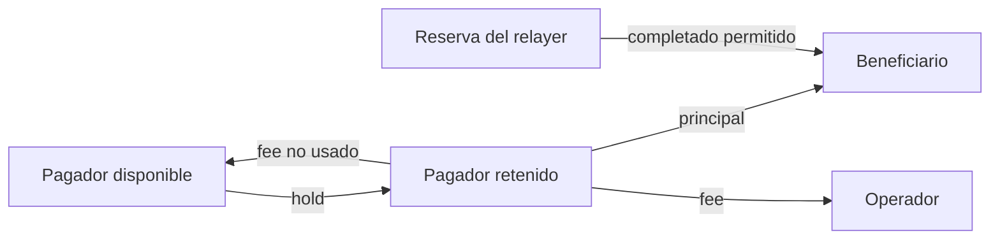

# Modelo económico y conservación

Todas las cantidades son enteras no negativas en unidades del activo declarado. `Amount` usa `int64` con validaciones de signo y overflow; los cálculos de fee por bps redondean al alza.

```text
locked = principal + fee_limit
route_fee = base_fee + ceil(principal × fee_bps / 10 000)
          + suma(ceil(principal × hop_fee_bps / 10 000))
settlement_debit = principal + route_fee
fee_refund = fee_limit − route_fee
```

La ruta se rechaza si el fee calculado supera el límite del mensaje. Por ejemplo, 1.000 USDC por una ruta de 20 bps cuesta 2 USDC. Si `fee_limit = 25`, se bloquean 1.025, se aplican 1.002 y se liberan 23. Una ruta alternativa con base 2 y 25 bps costaría 5 USDC para el mismo principal.



Cuando la política autoriza completar desde reserva y el retenido no cubre el cargo, `ChargeHeldOrReserve` consume primero saldo retenido y después reserva. `ChargeSource` detalla ambos importes. Con la opción deshabilitada, el motor rechaza un cargo que dependa de reserva. Las vistas `available` y `held` permiten reconciliar por cuenta.

`Ledger.AssertConserved` compara el total por activo tras cada secuencia con el total registrado al inicializar cuentas. Los movimientos entre cuentas no alteran el total, aunque cambien disponibilidad, retención y titularidad. Este control se complementa con la validación de importe, política y estado de cada operación.
