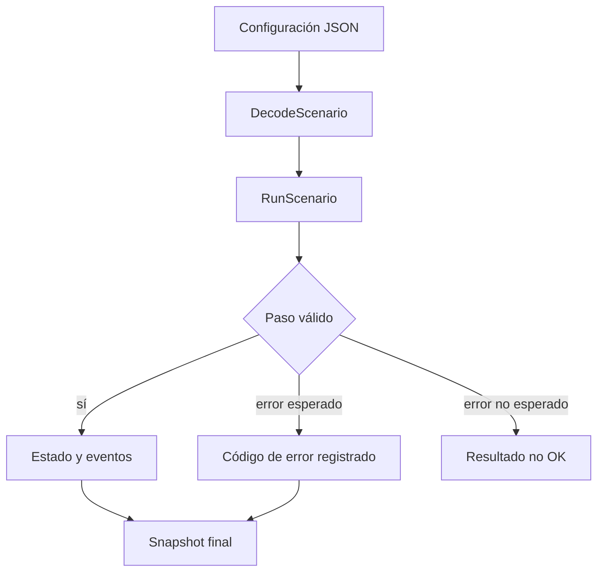

# Operación local

## Preparación y validación

```bash
go run ./cmd/relaydtl --scenario ./examples/settlement.json
go test ./...
go vet ./...
npm ci
npm test
bash scripts/ci.sh
```

En Windows, `.\scripts\ci.ps1` ejecuta la misma validación. El script Bash comprueba `gofmt` sin escribir archivos en `/tmp`; después ejecuta `go vet`, instala dependencias con el lockfile y corre ambas suites. La CLI devuelve un JSON con `steps` y `snapshot`.



Para verificar el ejemplo, compruebe `ok: true`, cinco pasos, principal 1.000, fee 2 y total USDC 15.000. El pagador termina con 8.998 disponibles; el beneficiario con 1.000 y el operador con 2. El saldo de reserva permanece en 5.000.

Un escenario no persiste estado entre procesos. Los snapshots son reproducibles con los mismos datos y versión, pero la CLI no sustituye monitorización de un servicio distribuido. Los workflows de versión comparan `main`, `production` y el tag anotado antes de considerar íntegro un release.
