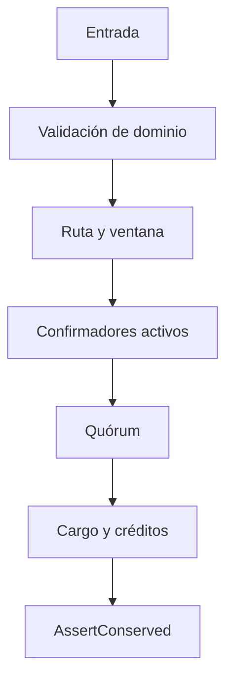

# Controles de seguridad operativa

| Superficie | Control | Salida observable |
| --- | --- | --- |
| Mensaje | ID, TTL, saldo retenido y límite de fee | Estado y eventos de hold |
| Ruta | Capacidad, activo, extremos y ventana | Recibo y digest |
| Nodo | Registro, actividad y peso efectivo | Confirmación |
| Quórum | Peso entregado y peso de rechazo | `ConfirmationView` |
| Recibo | Contexto, importe, vencimiento y estado | `ReceiptEffect` |
| Libro | Disponibilidad, retención y conservación | `RelayerSnapshot` |
| Reserva | Política de completado y fuente de cargo | `ChargeSource` |

Los límites de capacidad, peso y fee operan en dominios distintos; una señal contable global no reemplaza las validaciones de cada transición. El motor local no tiene autenticación criptográfica, persistencia ni garantías de entrega de red. Una implementación distribuida necesita controles adicionales de identidad, atomicidad, idempotencia, observabilidad y recuperación.

La recepción privada de hallazgos se describe en [SECURITY.md](../SECURITY.md).
