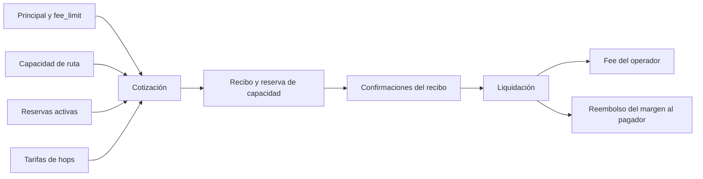
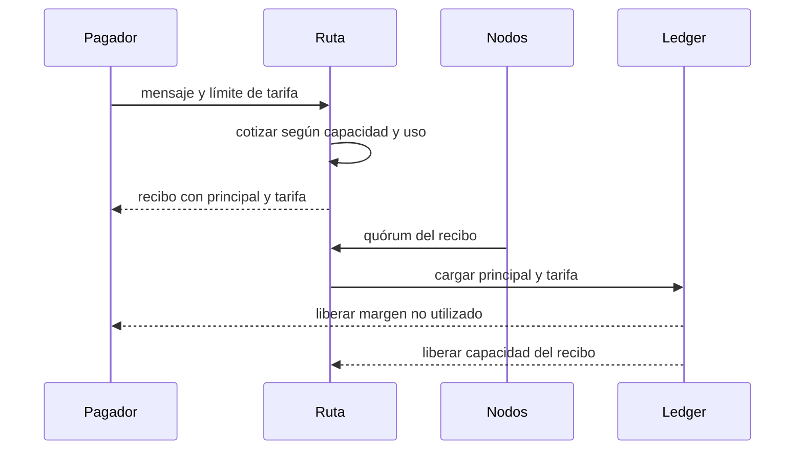

# Tarifas de ruta y capacidad comprometida

La tarifa de RelayDTL tiene cuatro componentes: base fija, porcentaje por
ruta, porcentajes por hop y prima opcional de congestión. Todos se expresan en
unidades enteras del activo del mensaje. Los componentes variables se
redondean hacia arriba; el recibo conserva la tarifa cotizada y el operador
recibe exactamente ese importe cuando se liquida.

`congestion_bps` se limita a 10.000. Con valor cero no modifica el modelo
anterior. Con un valor positivo, el motor toma la capacidad de la ruta, lo ya
reservado y el principal nuevo para calcular una prima no lineal de uso. Una
ruta sin capacidad no puede activar ese parámetro. La selección de ruta
compara la tarifa completa y no solo el porcentaje base.

Ejemplo: capacidad de 1.000.000 unidades, reserva inicial cero, mensaje de
400.000 y `congestion_bps = 5.000`, sin fee base ni de hops. El recibo cotiza
una prima de 32.000 unidades. Con un `fee_limit` de 150.000 se retienen
550.000 unidades (`400.000 + 150.000`); al liquidar se entregan 400.000 al
beneficiario, 32.000 al operador y 118.000 vuelven al disponible del pagador.
El inventario de ruta se libera al terminar el recibo, mientras la
conservación total del activo permanece inalterada.

La reserva de ruta limita admisiones simultáneas, pero no sustituye el saldo
retenido del pagador ni la reserva monetaria del relayer. La prima es ingreso
del operador; no es un depósito de capital ni una quema. Para conciliar, sume
el fee de los recibos liquidados por operador, el margen reembolsado a cada
pagador y los cambios de reserva de capacidad. Los recibos pendientes no
deben generar ingreso antes de liquidarse.
